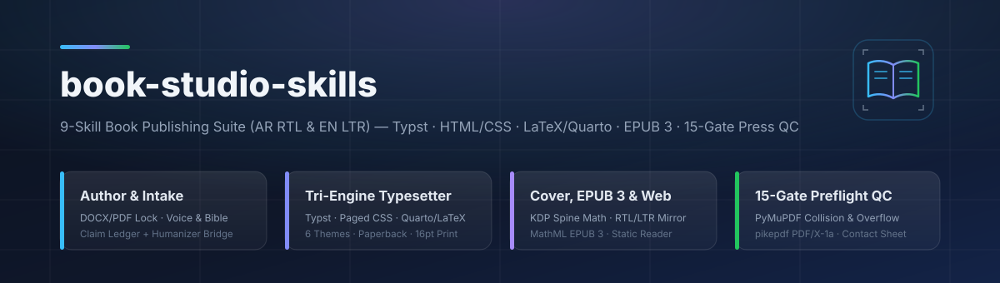

<div align="center">



<br/>

**حزمة متكاملة ثنائية اللغة (العربية `RTL` + الإنجليزية `LTR`) لتأليف الكتب وهندستها وتنضيدها عبر ٣ محركات (`Typst` · `HTML/CSS Paged Media` · `LaTeX/Quarto`) وبناء الأغلفة الطباعية الكاملة وإنتاج `EPUB 3` وموقع القراءة الثابت وفحص ما قبل المطبعة بـ ١٥ بوابة فيزيائية — تضم ٩ مهارات قياسية ([Agent Skills](https://agentskills.io)) وأمر `/book` و١٠ أدوات برمجية، متوافقة مع `OpenCode` و`Claude Code` و`Codex CLI` و`DeepSeek Harness`.**

[](https://github.com/abduallahJamal/book-studio-skills/actions/workflows/validate.yml)
[](#المهارات-التسع-في-الحزمة)
[](#التنضيد-ثلاثي-المحركات-والطبعات-الأربع)
[](#هندسة-الطباعة-العربية-rtl-الأصيلة)
[](#بوابات-الفحص-الفيزيائي-الخمس-عشرة-قبل-المطبعة)
[](#التثبيت-السريع)
[](#التثبيت-السريع)
[](#التثبيت-السريع)
[](#التثبيت-السريع)
[](LICENSE)

**[🇬🇧 English](README.md)** · **🇪🇬 العربية**

</div>

---

<div align="right" dir="rtl">

## 📌 لماذا ٩ ورش متخصصة بدلاً من قالب واحد؟

تفشل أدوات الكتب التقليدية عند الانتقال إلى الطباعة الحقيقية على Amazon KDP وIngramSpark والمطابع التجارية لأربعة أسباب متكررة: تخمين عدد الصفحات قبل انتهاء التنضيد يزحزح كعب الغلاف فوق الواجهة الأمامية؛ بقاء روابط الفهرس التفاعلية (`/Annots`) داخل الـ PDF يجعل Ghostscript يلغي وضع `PDF/X-1a` بصمت؛ الجداول الطويلة غير القابلة للانقسام تتراكب أسطرها فوق بعضها؛ وتطبيق قوالب الكتب الإنجليزية (`LTR`) على كتاب عربي (`RTL`) يضع الغلاف الأمامي في الخلف!

تجمع حزمة `book-studio-skills` أقوى الابتكارات الهندسية من **٩ مشاريع مفتوحة المصدر** في **٩ مهارات مستقلة غير متضاربة** تحكمها سلسلة اعتمادية صارمة (`المقاس ← تنضيد المتن الفعلي ← قراءة العدد الحقيقي للصفحات ← حساب الكعب وبناء الغلاف ← ١٥ بوابة فحص فيزيائي`)، مع تكامل مباشر مع حزمة [`abduallahJamal/humanizer-skills`](https://github.com/abduallahJamal/humanizer-skills) لتنقية النص من بصمات الذكاء الاصطناعي قبل التنضيد.

## 🧩 المهارات التسع في الحزمة

| المهارة | دور الورشة المتخصصة | الأداة البرمجية المدمجة | الجذور الهندسية المستخلصة |
| :--- | :--- | :--- | :--- |
| **[`book`](skills/book/SKILL.md)** | الموجّه الذكي (`/book`) وفحص البيئة وإنشاء المشروع وحراسة تسلسل الاعتماديات | `doctor.py`, `init_book.py` | `cdeistopened/book-studio` |
| **[`book-intake`](skills/book-intake/SKILL.md)** | استيراد وتوحيد ملفات `.docx` و`.pdf` و`.md` مع الحواشي والجداول وقفل بصمة المحتوى | `import_manuscript.py` | `yoelf22` (`import-docx.py`), `markitright`, `paper_format_agent` |
| **[`book-architect`](skills/book-architect/SKILL.md)** | تخطيط الكتاب من الصفر: `outline.json`، قفل الصوت (`Voice Lock`)، و`Book/Art Bible` | `scaffold_outline.py` | `epicsagas/Velith` (Phases 0–2), `chesley-veko/book_skill` |
| **[`book-drafter`](skills/book-drafter/SKILL.md)** | كتابة الفصول باتساق سردي + دفتر الحقائق + التحرير السباعي والربط مع `humanizer-skills` | `manuscript_metrics.py` | `epicsagas/Velith` + `humanizer-skills` |
| **[`book-illustrator`](skills/book-illustrator/SKILL.md)** | توليد وفحص مخططات `SVG` نقية وفحص دقة `300 DPI` وتفريغ الخلفيات بـ `Pillow` | `prepare_figures.py` | `chesley-veko/book_skill`, `gongnyang/bookforge` |
| **[`book-typesetter`](skills/book-typesetter/SKILL.md)** | محرك التنضيد الثلاثي (`Typst` + `HTML/CSS` + `LaTeX/Quarto`) بـ ٦ ثيمات و٤ طبعات وحارس بصمة الكلمات | `build_interior.py` | `felipefontoura/book-kit`, `rxpelle/book-formatter`, `bookforge` |
| **[`book-cover-wrap`](skills/book-cover-wrap/SKILL.md)** | حساب سماكة الكعب من الـ PDF الفعلي وبناء الغلاف الكامل (`RTL` معكوس أو `LTR`) وغلاف المتجر | `calc_and_render_cover.py` | `cdeistopened/kdp-cover-wrap`, `yoelf22`, `book-kit` |
| **[`book-ebook-web`](skills/book-ebook-web/SKILL.md)** | إنتاج وفحص `EPUB 3.3` قياسي (`MathML` + اتجاه تقليب `RTL`) + موقع ويب ثابت للكتاب | `build_epub_and_web.py` | `rxpelle/book-formatter`, `felipefontoura/book-kit` |
| **[`book-preflight-qc`](skills/book-preflight-qc/SKILL.md)** | نزع الروابط وتجهيز `CMYK PDF/X-1a` + **١٥ بوابة فحص فيزيائي بـ PyMuPDF** وألواح المعاينة البصرية | `press_pdfx.py`, `preflight_qc.py` | `gongnyang/bookforge` (`qc_gate.py`), `yoelf22` (`verify-pdfx.py`) |

---

## 🌍 هندسة الطباعة العربية (`RTL`) الأصيلة

على خلاف الأدوات المصممة للغات اللاتينية فقط، تتكيف جميع القوالب والمعادلات الهندسية تلقائياً مع الكتب العربية (`"direction": "rtl"`):

1. **انعكاس لوحة الغلاف الكامل تلقائياً (`RTL Wraparound Cover Mirroring`):**
   - في الكتاب الإنجليزي (`LTR`): يقع الغلاف الخلفي يسار الكعب والغلاف الأمامي يمين الكعب.
   - في **الكتاب العربي (`RTL`)**: **تنعكس اللوحة بالكامل!** يوضع **الغلاف الأمامي يسار الكعب** و**الغلاف الخلفي (مع منطقة الباركود البيضاء المحمية `2.0 × 1.2 in`) يمين الكعب** ليطابق التجليد اليميني الصحيح.
2. **هوامش التجليد المعكوسة وعزل الكود والمعادلات (`BiDi Isolation`):**
   - تُضبط هوامش التجليد الداخلية (`Inside Gutter`) لليمين في الصفحات الفردية ولليسار في الصفحات الزوجية، مع عزل مربعات الأكواد البرمجية والمعادلات بـ `dir="ltr"` حتى لا تنقلب الأقواس والرموز داخل السياق العربي.
3. **اتجاه تقليب الصفحات في الكتب الإلكترونية (`EPUB 3 RTL Spine`):**
   - ضبط `page-progression-direction="rtl"` داخل `OEBPS/content.opf` ليعمل التقليب من اليمين لليسار بسلاسة على Kindle وApple Books وKobo وأبجد.

---

## ⚙️ التنضيد ثلاثي المحركات والطبعات الأربع

من ملف إعداد واحد (`book.config.json`) ومجلد مخطوطة واحد (`manuscript/`)، ينتج `build_interior.py`:

- **٣ محركات تنضيد:** **Typst** (المحرك الأساسي فائق السرعة)، **HTML/CSS Paged Media** (للكتب البصرية والمجلات)، و**LaTeX/Quarto** (`LuaLaTeX` + `babel` للأبحاث والكتب الأكاديمية).
- **٤ طبعات متزامنة:** `paperback` (ورقية)، `hardcover` (غلاف مقوى بهوامش مفصلية أوسع)، `large-print` (طبعة الخط الكبير `16pt` لكبار السن وضعاف البصر)، و`screen` (نسخة الشاشة التفاعلية بخلفية مريحة وروابط نشطة، بينما تُجرد طبعات الورق من أي لون خلفية ومن جميع الروابط التفاعلية).
- **٦ حزم تصميم جاهزة ثنائية اللغة:** `trade-nonfiction`، `literary-novel`، `technical-code`، `academic-monograph`، `executive-report`، و`classic-arabic-turath` (للنصوص التراثية والأدبية العربية المشكولة).

---

## 🛡️ بوابات الفحص الفيزيائي الخمس عشرة قبل المطبعة

لا ينتقل أي ملف إلى مجلد الاعتماد النهائي `dist/press-ready/` إلا بعد اجتياز البوابات الـ ١٥ في `preflight_qc.py`:

- **`G01`–`G05` (الهندسة والخطوط وملف المطبعة):** مطابقة `MediaBox/TrimBox` بدقة `±0.5pt`، زوجية الصفحات (`>= 24`)، تضمين الخطوط ١٠٠٪ ومنع خطوط `Type3`، خلو الملف تماماً من `/Annots`، ووجود تعريف `GTS_PDFX`.
- **`G06`–`G11` (فحص الإحداثيات الفيزيائية بـ PyMuPDF):** منع الخروج عن منطقة الأمان، كشف تصادم وتراكب الأسطر والجداول، منع العناوين اليتيمة أسفل الصفحة، مطابقة أرقام الفهرس، التحقق من دقة الصور `>= 300 DPI`، ومنع خلفية الشاشة الرمادية في الطباعة السوداء.
- **`G12`–`G15` (نزاهة المحتوى والغلاف والمعاينة البصرية):** توثيق أرقام الصناديق البارزة، فحص انعكاس الغلاف العربي ومنع نص الكعب تحت `79` صفحة وحماية الباركود، مطابقة بصمة الكلمات والأرقام ١٠٠٪ مع المخطوطة الأصلية، وتوليد ألواح المعاينة البصرية (`contact-sheet-interior.png` و`contact-sheet-cover.png`).

---

## 🚀 التثبيت السريع

</div>

```bash
git clone https://github.com/abduallahJamal/book-studio-skills.git
cd book-studio-skills

# تثبيت مكتبات الطباعة الاحترافية + تثبيت المهارات التسع على جميع المنصات الأربع دفعة واحدة
./install.sh --all --global --install-deps

# فحص جاهزية البيئة والخطوط العربية والإنجليزية ومحرك Typst
python3 skills/book/scripts/doctor.py

# أو التثبيت داخل مشروع كتاب محدد
./install.sh --all --project /path/to/your-book
```

<div align="right" dir="rtl">

**على نظام Windows (PowerShell):**

</div>

```powershell
pip install -r requirements.txt
.\install.ps1 --target all --scope global
```

---

<div align="right" dir="rtl">

## 🛠️ مصفوفة التوافق مع المنصات الأربع

| المنصة | مسار المشروع | المسار العام للمستخدم | طريقة الاستدعاء | التوافق الهندسي المدمج |
| :--- | :--- | :--- | :--- | :--- |
| **OpenCode** | `.opencode/skills/` | `~/.config/opencode/skills/` | `/book` أو تلقائياً | ترويسة `YAML` قياسية + أمر `.opencode/commands/book.md` |
| **Claude Code** | `.claude/skills/` | `~/.claude/skills/` | `/book`, `/book-typesetter` | ملفات `.claude-plugin/plugin.json` و`marketplace.json` |
| **Codex CLI** | `.agents/skills/` و`.codex/skills/` | `~/.agents/skills/` و`~/.codex/skills/` | `$book`, `$book-cover-wrap` | ملفات `agents/openai.yaml` لكل مهارة + `.agents/plugins/marketplace.json` |
| **DeepSeek Harness** | `.dsh/skills/` (الأولوية 100) | `~/.dsh/skills/` (`$DSH_HOME/skills`) | `skill({ name })` / لوحة الأوامر | **تخطيط مسطّح من مستوى واحد** متوافق مع فاحص `@deepseek-ai/dsh-skill-filesystem` |

---

## 🧪 تجربة عملية كاملة على الكتاب العربي التجريبي المدمج

يتضمن المستودع نموذجين كاملين جاهزين للتجربة الفورية في [`examples/arabic-rtl-book`](examples/arabic-rtl-book/book.config.json) (كتاب عربي `RTL`) و[`examples/english-ltr-book`](examples/english-ltr-book/book.config.json) (كتاب إنجليزي `LTR`):

</div>

```bash
# 1. توليد مخطط SVG المتجهي وقفل بصمة المخطوطة
python3 skills/book-illustrator/scripts/prepare_figures.py \
  --project examples/arabic-rtl-book \
  --render-pipeline-svg examples/arabic-rtl-book/assets/figures/pipeline.spec.json \
  --out examples/arabic-rtl-book/assets/figures/fig-01-pipeline.svg
python3 skills/book-intake/scripts/import_manuscript.py --project examples/arabic-rtl-book --lock-only

# 2. فحص إيقاع الجمل وخلو الفصول من التكرار وبصمات الذكاء الاصطناعي
python3 skills/book-drafter/scripts/manuscript_metrics.py --project examples/arabic-rtl-book --strict

# 3. تنضيد الطبعات الأربع والمحركات الثلاثة مع التحقق من بصمة المحتوى
python3 skills/book-typesetter/scripts/build_interior.py --project examples/arabic-rtl-book --engine all --edition all

# 4. حساب عرض الكعب من الـ PDF الفعلي وبناء الغلاف العربي المعكوس (RTL) وغلاف المتجر
python3 skills/book-cover-wrap/scripts/calc_and_render_cover.py --project examples/arabic-rtl-book

# 5. بناء ملف EPUB 3.3 (باتجاه تقليب RTL ومعادلات MathML) وموقع القراءة التفاعلي
python3 skills/book-ebook-web/scripts/build_epub_and_web.py --project examples/arabic-rtl-book

# 6. تجهيز ملفات المطبعة واجتياز البوابات الفيزيائية الـ 15 ونقلها إلى dist/press-ready/
python3 skills/book-preflight-qc/scripts/press_pdfx.py --project examples/arabic-rtl-book --cmyk
python3 skills/book-preflight-qc/scripts/preflight_qc.py --project examples/arabic-rtl-book
```

<div align="right" dir="rtl">

---

## 📄 الرخصة

مرخّص بموجب رخصة [MIT License](LICENSE).

</div>
