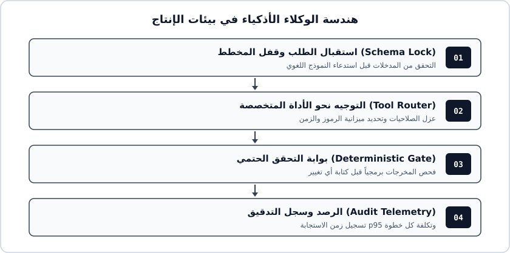

# الفصل الأول: لماذا تنهار النماذج التجريبية عند أول مستخدم حقيقي؟

في الساعة التاسعة صباحاً أطلق الفريق مساعده الذكي لخدمة العملاء. بحلول الظهيرة كان النظام قد أصدر ثلاثين استرداداً مالياً مخالفاً للسياسة، واستدعى واجهة الشحن أربع عشرة مرة لنفس الطلب. ماذا حدث؟ العرض التجريبي عمل بالأمس دون خطأ واحد!

السر يكمن في رياضيات الاحتمالات المركبة[^1]. حين تنجح كل خطوة منفردة بنسبة 92%، يظن المطور المبتدئ أن نظامه ممتاز. لكن ربط 6 خطوات متتالية يخفض احتمال نجاح الرحلة الكاملة إلى 60.6% فقط، وفق المعادلة الصريحة $P = 0.92^6 = 0.606$.

> قاعدة أساسية: موثوقية 92% في الخطوة الواحدة تهبط عبر 6 خطوات متتالية إلى 60.6% فقط عند غياب بوابات التحقق.

## تشريح الأعطال الصامتة في الأنظمة الوكيلية

لا تنهار الأنظمة الوكيلية عادةً برسالة خطأ صريحة في الطرفية، بل تنزلق بهدوء عبر ثلاث ثغرات متكررة:

1. **تلوث السياق التراكمي:** كل أداة تعيد كائناً ضخماً بصيغة `JSON` تستهلك نافذة التركيز وتشتت القرار التالي.
2. **غياب التماثل التكراري (`Idempotency`):** إعادة المحاولة عند انقطاع الشبكة تنفذ العملية المالية مرتين ما لم يحمل كل طلب مفتاح تفرد صريح.
3. **الخلط بين الفهم والحساب:** تكليف النموذج اللغوي بجمع الفواتير أو فحص التواريخ بدلاً من تمريرها إلى دالة برمجية دقيقة.

يوضح المخطط السابق كيف نعزل الاستدلال اللغوي داخل طبقة توجيه محكومة بين قفل المدخلات وبوابة التحقق النهائية.

[^1]: تُعرف هذه الظاهرة في هندسة الاعتمادية بتآكل الموثوقية المتسلسلة في الأنظمة متعددة المراحل.
