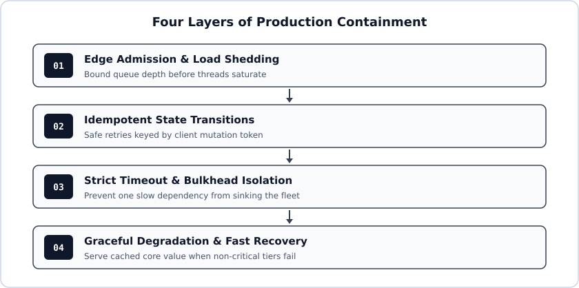

# Chapter 1: Retries Are Amplifiers in Disguise

A thirty-second database hiccup should cause thirty seconds of errors. Instead, it took the payment platform offline for four hours. Nobody pushed bad code that afternoon. Three well-meaning retry loops did the wrecking all by themselves.

Here is the arithmetic most teams miss until it hurts[^1]. Suppose an API gateway retries failed calls 3 times, the order service retries 3 times, and the ledger client retries 3 times. Each layer turns 1 request into 4 attempts. Across 3 stacked tiers, a single user click explodes into $4^3 = 64$ database queries right when the database is already gasping for CPU.

> Field rule: Three stacked tiers each configured with 3 retries multiply downstream pressure up to 64 times during a slowdown.

## Token-Bucket Retry Budgets

Stop configuring retries per request in isolation. Enforce a process-wide retry budget instead:

1. Credit a local token bucket with 0.1 tokens for every normal request sent.
2. Spend 1.0 token whenever a call needs a retry.
3. If the bucket hits zero, fail fast without retrying!

During healthy traffic, rare packet drops retry immediately because the bucket stays full. During a real outage, retries cap themselves at 10% overhead and stop hammering the recovering server.

[^1]: Multiplicative retry storms remain one of the most common root causes in cloud postmortems.
